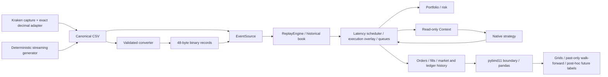

# Architecture

microback is a sequential, single-instrument C++20 event-driven simulator. Exchange
payloads are normalized outside the native hot path into integer canonical records.

OrderBook uses descending bid and ascending ask maps of stable FIFO order lists,
plus an unordered ID index holding list iterators and stable level pointers. It is
noncopyable/nonmovable to preserve index lifetime. Cancels use the ID index; quantity
increases and price changes lose priority, reductions retain it. Aggregate quantity
lookup returns a value through a const API. No custom ladder or concurrent hot loop.

Replay validates source order, domain fields and uncrossed updates. Snapshots stage
in a separate book and publish atomically at an end marker. Failed replay is sticky
until reset. EventSource owns CSV/binary streams or in-memory fixtures. Venue parsing
and real-data collection are Python; native simulation knows no JSON/venue rules.

Execution owns historical replay, a causal submit/cancel priority queue, client
orders, fills, portfolio, risk and shadow consumed/trade quantities. Historical
orders remain factual; simulated orders do not rewrite history. Arrivals before an
external event use the preceding book; equal-time actions follow the first published
external event. Passive queue models are estimates. Context exposes const state and
controlled request methods, not history, external clock advance or future labels.
Hooks observe ledger/order updates after fills; callbacks receive actual arrival time.
Timers stop at the data horizon. No automatic future fills or forced closing trade.

Portfolio uses checked signed 128-bit atoms: tick*lot/1,000,000. Cash and position are
authoritative; doubles are reporting only. Risk reserves pending/live directional
exposure rather than netting opposite requests. Notional caps are submission estimates,
not dynamic guarantees after price moves. Margin-style negative cash is allowed.

pybind11 releases the GIL while running native strategies, then materializes Python
results. Monetary integers are lossless; prices/lots/ns/IDs are typed DataFrame integer
columns. Python grids are serial independent runs; no shared batch concurrency,
per-event callbacks or TSan requirement. Post-hoc analytics cannot feed back into the
native Context. Walk-forward freezes choices before each independent test window.

Read execution-model.md, accounting-risk.md and data-format.md for precise contracts.
Benchmark workloads exclude native event generation; reporting/history allocation is
outside plain replay performance claims. The measured optimization removed repeated
full-depth copies for individual execution quantity lookups.

Context belongs to a run. Reacquire the book through Context in each callback:
references to a prior historical book become invalid when a snapshot publishes or
replay resets. Retaining Context/book references past those boundaries is unsupported;
the two supplied strategies retain only value IDs, never borrowed book pointers.
