# Reproducible execution research

The reference strategies lose money after the configured scenario fees on this
119.616-second Kraken capture. Queue assumptions materially change fills and PnL;
latency changes the number and timing of submissions. These are execution-model
observations from one short receipt-ordered L2 stream, not evidence of trading alpha.
The constant-price synthetic stream supplies a reproducibility control, rather than
a realistic return distribution.

## Data, configuration and units

The [Kraken capture manifest](../datasets/kraken-btc-usd.json) records 11,862 canonical
events, first/last local receipt timestamps, CRC32 validation, zero observed trade-ID
gaps, and SHA-256 checksums. The frozen CSV SHA-256 is
`6b7b4e4ec935e32a164127a8563ef028ba5063c7aa4654bb4d1406e11ae81ad2`.
Raw JSONL/CSV/binary files and derived window CSVs remain outside Git; no
redistribution license is asserted. See [data conventions](../data-format.md).

One price tick is $0.10 and one quantity lot is 0.00000001 BTC. Thus one tick*lot
is $0.000000001; one monetary atom is $0.000000000000001. Tables keep native
integer atoms plus reporting tick*lot amounts; the USD values below multiply
reported tick*lots by 1e-9. Real-data initial cash is $1,000, order size is 100,000
lots (0.001 BTC), and engine maximum position is 1,000,000 lots (0.01 BTC).
The imbalance strategy uses five levels, entry 0.35 and flatten threshold 0.10.

All runs use seed 7, deterministic native strategies, maker fee 100 ppm and taker
fee 200 ppm. These fees are explicit scenarios, not an asserted Kraken account tier.
Submit/cancel latency is constant and equal; the default queue is conservative.
The maker's position cap is 500,000 lots and allowed spread is 1–10,000 ticks.
Its real-data integer skew is zero because one tick per 1e-8 BTC lot would produce
an impractical quote displacement; inventory is still limited. The synthetic maker
uses one tick per lot, size one and position cap ten. Complete inputs, versions and
source hashes are in the [real](kraken/manifest.json) and
[synthetic](synthetic/manifest.json) manifests.

## Latency sensitivity

[Full imbalance grid](kraken/latency.csv), including fees, turnover, fill ratio,
slippage, exposure and risk statistics:

| Submit/cancel latency (us) | Fill records | Gross PnL ($) | Net PnL ($) |
| --- | ---: | ---: | ---: |
| 0 | 403 | 0.017187 | -6.564131 |
| 50 | 382 | 0.029809 | -6.175417 |
| 100 | 364 | 0.041843 | -5.889929 |
| 250 | 357 | 0.041015 | -5.719846 |
| 500 | 351 | 0.052543 | -5.605785 |
| 1000 | 351 | 0.045983 | -5.578148 |

Zero-latency fees are $6.581318 against $32,906.591843 turnover. Higher latency
reduces turnover and fees in this particular run, so the smaller net loss does not
establish a general benefit of latency. L2 packet changes are published as multiple
canonical level events at the same receipt time. Zero-latency strategies can react
to intermediate packet states; delayed requests suppress some such reactions.
Cross-channel book/trade ordering is local receipt order. Consequently sub-millisecond
sensitivity includes normalization and observation artifacts, beyond modeled order
arrival. The capture cannot validate actual exchange queue position or network delay.

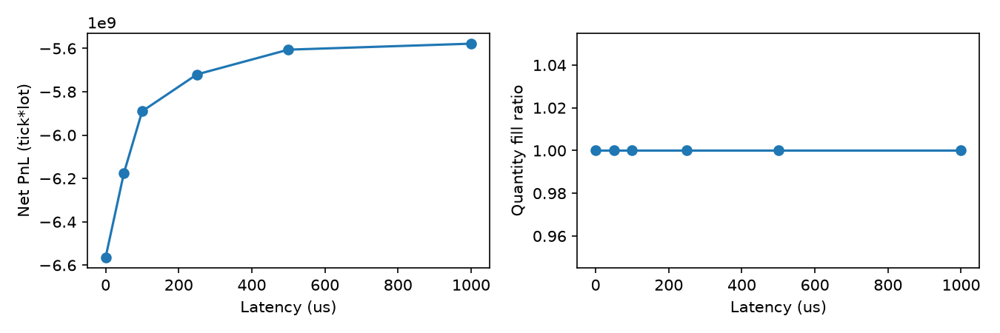

The [maker latency grid](kraken/maker-latency.csv) is a second sensitivity check:
net PnL ranges from -$0.033880 at zero latency to -$0.259360 at 1000 us,
with 22–29 fill records across the nonzero-latency cases. This is also one-path
sensitivity, without confidence intervals or an out-of-sample performance claim.

## Queue assumptions and passive execution

The maker is compared at 50 us with all other parameters fixed.
[Full queue table](kraken/queues.csv):

| Queue model | Fill records | Quantity fill ratio | Gross PnL ($) | Fees ($) | Net PnL ($) | Maker spread capture (ticks) |
| --- | ---: | ---: | ---: | ---: | ---: | ---: |
| Conservative | 28 | 0.059651 | 0.084113 | 0.218759 | -0.134646 | 3.098956 |
| Neutral | 72 | 0.076377 | -0.100061 | 0.271236 | -0.371297 | 2.547400 |
| Optimistic | 82 | 0.103590 | -0.146847 | 0.339879 | -0.486726 | 1.952842 |

More generous cancellation assumptions increase participation and losses on this
path. A maker strategy can submit a quote that crosses by arrival: conservative-run
maker volume fraction is 54.5381%, and taker fraction is 45.4619%. Liquidity
classification and actual taker scenario fees are retained. Quantity fill ratio
counts all fills divided by all requested quantity (including rejected requests); replacement submissions
increase its denominator. It is not a measured exchange fill probability.
Filled-order fraction is 8.81356% in the conservative case.

Conservative maker mean inventory is -307,883.9195 lots, maximum absolute inventory
491,466 lots (0.00491466 BTC). Mean gross midpoint exposure is $270.294858;
maximum is $420.200481. End inventory is marked, without forced liquidation.
Queue models infer cancellation position from aggregated L2 changes. Passive fills
require same-price prints; price-through fills and market impact are not inferred.
See [execution semantics](../execution-model.md) and [assumptions](../assumptions.md).

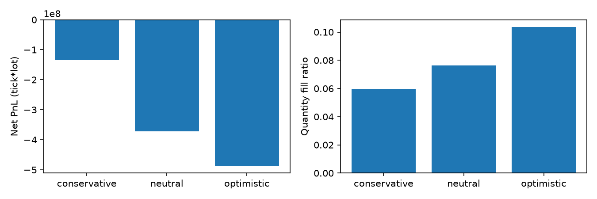
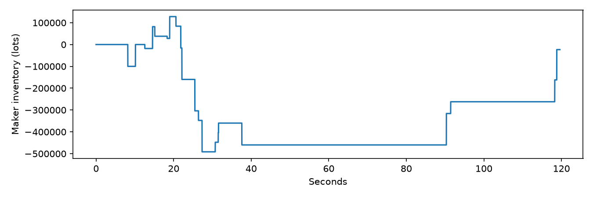

## Post-fill adverse selection

Only **maker-classified fills** contribute to the passive study. For side sign
+1 buy/-1 sell, signed midpoint move is sign*(future mid − arrival mid), and markout
is sign*(future mid − fill price). Positive means favorable. Values below are
unweighted means across available fill records; spread capture above is
quantity-weighted. Labels are calculated after the simulation, never supplied to
strategies, and retained in [the label table](kraken/adverse-selection.csv).

| Horizon (ms) | Valid maker fill labels | Signed midpoint move (ticks) | Markout from fill (ticks) |
| --- | ---: | ---: | ---: |
| 1 | 20 | -19.825000 | -16.050000 |
| 10 | 20 | -22.675000 | -18.900000 |
| 100 | 20 | -26.525000 | -22.750000 |
| 1000 | 19 | -29.657895 | -25.710526 |

Future midpoint is backward-as-of at fill time plus horizon. Labels beyond the
observed end or whose available midpoint is older than the horizon are censored.
Even uncensored 1/10 ms labels reflect receipt-time observations; sparse updates
can retain the last known midpoint and do not reveal exchange-time dynamics.
All imbalance fill labels are separately saved in
[imbalance-adverse-selection.csv](kraken/imbalance-adverse-selection.csv).

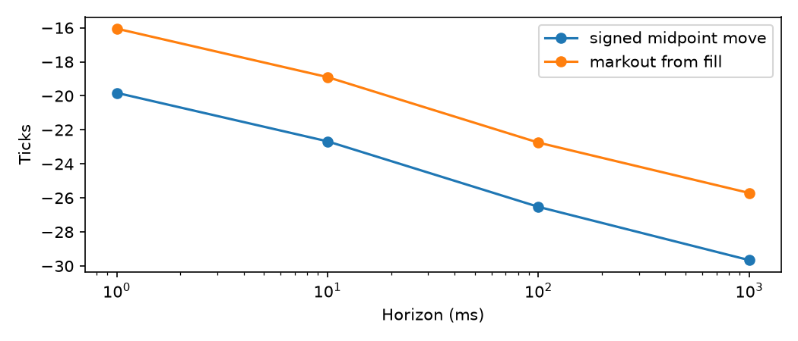

## Cost ablations

The ideal counterfactual uses exactly the zero-latency run's actual fill times,
sides and quantities, substituting the decision midpoint for execution price.
Fractional midpoint prices exist only in this reporting calculation. No additional
fills are invented. The fees-only case subtracts the original realized fee amounts,
so it isolates those amounts rather than repricing a venue fee schedule.
Exact ideal gross atoms = actual gross atoms + decision slippage atoms.

[Full ablation table](kraken/ablations.csv):

| Scenario | Fill records | Net PnL ($) |
| --- | ---: | ---: |
| Ideal decision midpoint, same fills, no fees | 403 | 0.169850 |
| Ideal decision midpoint, same fills, original fees | 403 | -6.411468 |
| Actual depth/queues, fees, zero latency | 403 | -6.564131 |
| Actual depth/queues, fees, 250 us | 357 | -5.719846 |

The last row has different fills and cannot be interpreted as a pure additive
latency cost. Net = gross − fees; decision/arrival slippage is already included
in gross and is displayed as an attribution, never subtracted again.

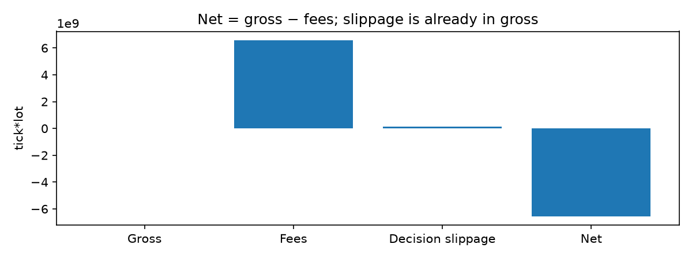

## Past-only walk-forward

Four disjoint chronological windows are generated from the frozen canonical CSV.
Each starts from a complete snapshot built from factual state strictly before the
split. Each test run starts flat with fresh cash. There is no portfolio carry-over.
For each of the three tests, only the immediately preceding window selects entry
threshold from [0.2, 0.35, 0.5] using net PnL; grid-order breaks ties. Thresholds
freeze before their test data is evaluated. Window checksums are in the manifests,
and future-window mutation tests verify that selection cannot change retroactively.

All three real-data tests selected 0.5; respective net PnL was -$1.068701,
-$0.618182 and -$0.811037. These tests also lose money. They demonstrate chronological
selection mechanics, not enough independent samples to estimate generalization.
[Full walk-forward results](kraken/walk-forward.csv) retain training scores and test
statistics. Neither this grid nor headline parameters were optimized on future
markout labels.

## Metrics and diagnostic plots

Risk maxima and maximum drawdown use the entire observed event history, including
between-grid events. Means and returns use backward-as-of sampling on a fixed
10 ms grid; plots of the imbalance path use 1 ms. Cash/equity/PnL differences are
formed from exact atoms before float reporting. Imbalance zero-latency maximum
drawdown is $6.567431 (0.656743% of running peak equity), mean position 19,260.9931
lots, maximum absolute position 100,000 lots, and maximum exposure $85.499400.

Sharpe uses sample return standard deviation (ddof=1), Sortino downside RMS relative
to zero, and annualization uses 365.25 days divided by the sampling interval.
Returns require positive equity; too few observations, zero variance, no downside,
or missing marks produce undefined values (None/blank). Annualizing two minutes
produces extreme ratios: these are diagnostic conventions, not credible annual
forecasts. Detailed definitions and API are in [Python API](../python-api.md).

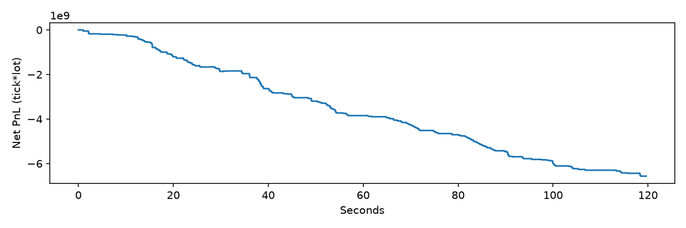
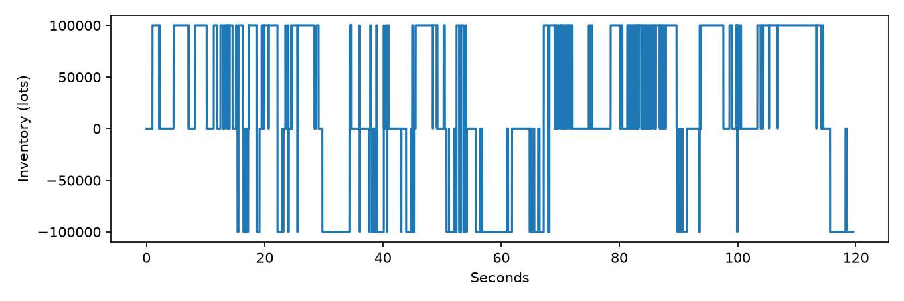
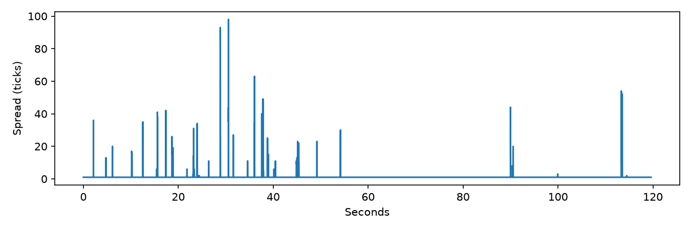
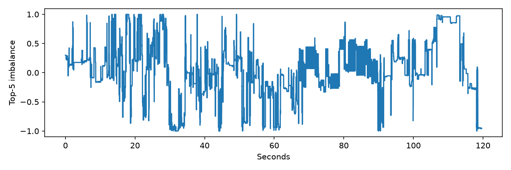
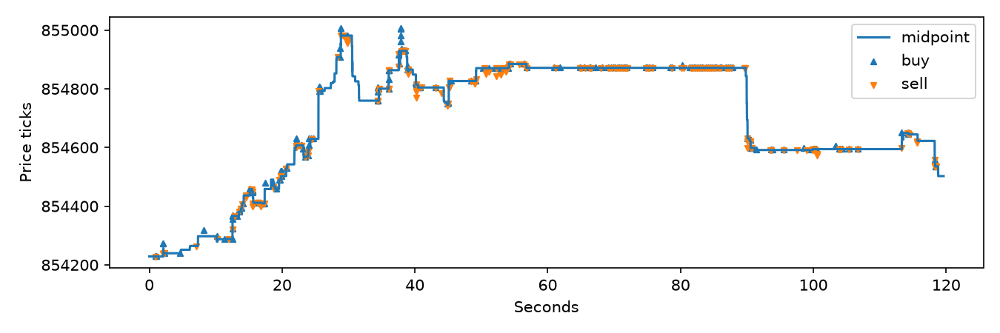

## Synthetic control and systems evidence

The 20,000-event deterministic control retains constant best prices and prescribed
quantity cycles/trades. All six imbalance latencies produce 399 fill records,
-662 tick*lots gross, 798.0418 fees and -1460.0418 net. The maker produces one fill,
one tick*lot gross and fee, net zero, quantity fill ratio 0.25 under every queue
model. These equalities are expected for this controlled stream; the synthetic
queue study is degenerate. The benchmark workload is kept fixed, without altering
prices or print correlations to manufacture a research result. Synthetic
[latency](synthetic/latency.csv), [queue](synthetic/queues.csv),
[ablation](synthetic/ablations.csv) and [walk-forward](synthetic/walk-forward.csv)
tables and corresponding plots are retained.

Five repeated native execution-update measurements at 100 levels reduced median
CPU time from 1164.27 to 60.59 ns/event after profiler-motivated direct aggregate
lookup, a 94.80% reduction (19.22x throughput). This benchmark excludes strategies
and result-history recording. It is not Python end-to-end performance.
CSV/binary bars use identical 10M-event warm-cache replay; execution bars use a
1M-event native stream. See [protocol and raw evidence](../benchmarking.md).
Linux hardware counters remain unexecuted; real macOS stack samples are retained.

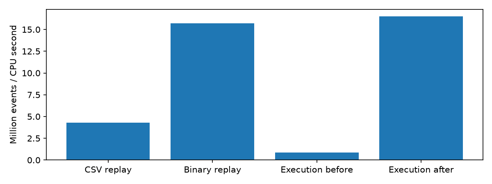

## Reproduction and verification

From the repository root, the public demonstration needs no account or real capture:

```bash
bash scripts/demo.sh
```

It builds/installs the package into `.venv`, generates the control and writes its
full research tables/plots to `output/demo`. Build dependencies may need network
access on the first run. For the two-dataset report, retain the frozen CSV with the
checksum above at `data/raw/kraken-btc-usd.csv`, then:

```bash
.venv/bin/python scripts/generate.py data/generated/small.csv
.venv/bin/python scripts/research.py --output output/research
.venv/bin/python scripts/research.py --output output/research-repeat
```

Exact original environment: Python 3.14.5, microback 0.1.0, NumPy 2.5.3,
pandas 3.0.6, Matplotlib 3.11.2, macOS 26.5 arm64; compiler/build details are in the
benchmark manifests and checkpoints. Pin these versions for byte comparisons;
other supported versions/platforms can change CSV/PNG formatting or last-bit
reporting. A new `scripts/collect_kraken.py` capture is independently reproducible
through the documented adapter, but it produces a different market path.

Two clean-wheel runs generated **53 byte-identical CSV/JSON/PNG artifacts**, including
window files; published artifacts omit those eight market-data window CSVs.
The manifests record parent commit b002d92 and dirty=true because measurements
preceded the final commit; per-file source hashes identify the exact measured code.
Rerunning after a commit changes Git provenance fields, so compare numerical/plot
artifacts directly and account for those fields when comparing manifests.
52 CTest cases passed in Debug, Release and ASan/UBSan, 13 Python tests passed in a
clean wheel environment, and 24 complete native results matched the preserved
pre-optimization extension. The one-command demo, benchmark build/static checks,
package build and formatting checks passed. See [review](../review.md) and
[checkpoint commands](../checkpoints.md). No remote is configured; Linux CI/perf
results are not claimed.
